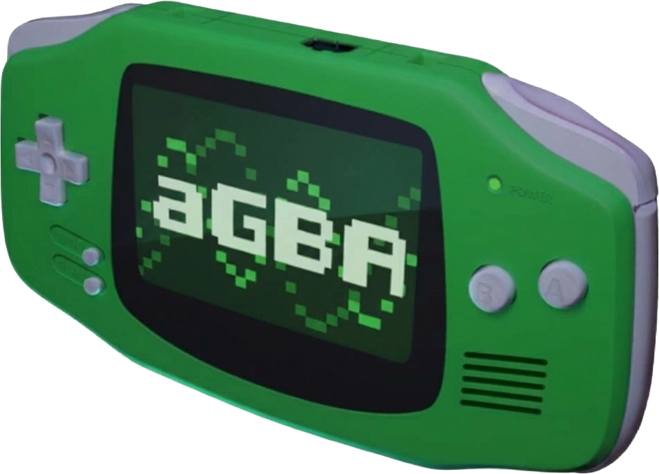

# aGBA

<div align="center">

</div>

<br>

aGBA is a GB, GBC, and GBA emulator for Android derived from [mGBA](https://github.com/mgba-emu/mbga) by Vicki Pfau and contributors.

- Official mGBA repository: https://github.com/mgba-emu/mgba
- Official mGBA website: https://mgba.io
- mGBA is licensed under the [Mozilla Public License 2.0](LICENSE). This repository, including the Android app, is distributed under the same license.
- [inih](https://github.com/benhoyt/inih) is included under the [New BSD license](mgba/src/third-party/inih/LICENSE.txt).

aGBA is not affiliated with or endorsed by the mGBA project.

## Features

- Library for GB, GBC and GBA with one ROM folder per platform
- Browse all platforms at once or filter by console, in list mode or cover mode
- Custom covers; the default cover is a light green gradient with the console icon
- Rename any game
- Home screen shortcuts that use your cover, or the console icon when there is none
- Touch controls laid out per console and orientation, editable in game or from Settings on a black screen, with D-pad or joystick, adjustable opacity, auto-hide after inactivity and optional hiding when a gamepad is connected
- Theme (automatic, light, dark), game orientation (follow device, portrait, landscape) and separate scaling for portrait and landscape
- OpenGL ES or software renderer, with Nearest, Linear, Sharp bilinear and FXAA filters
- English, Spanish and French (automatic by default, follows the phone language)
- Settings organised in categories
- Gamepad support with button remapping
- Save states with thumbnails, quick save/load and optional resume where you left off
- Rewind, adjustable fast-forward, screenshots
- Cheats (GameShark, Action Replay, CodeBreaker, Game Genie)
- GB palettes, SGB borders, model selection, optional BIOS files
- Rumble, tilt, gyroscope and solar sensor support
- IPS and UPS patches next to the ROM, ZIP archives

## Building

Requirements: JDK 21, Android SDK with platform 37, NDK `28.0.13004108` and CMake `3.22.1`.

```sh
make apk
```

The APK is written to `dist/aGBA-<version>.apk`. Other targets:

| Target | Description |
| --- | --- |
| `make apk` | Release APK |
| `make debug` | Debug APK |
| `make install` | Release APK installed with `adb` |
| `make clean` | Remove build output |

Pass `VERSION=1.2.3` to set the version name; the version code is derived from it.

<hr>

**aGBA is not affiliated with or endorsed by Nintendo.**
